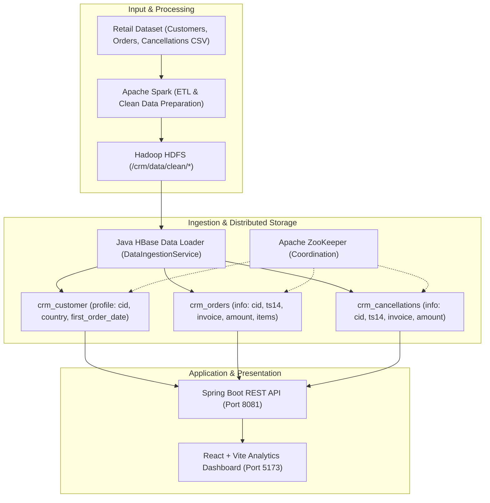

# HBase CRM – Project Description

Based on our previous discussions and the implementation completed so far, the project is being developed as a **Big Data-powered Customer Relationship Management (CRM) and Retail Analytics System** using Apache HBase, Hadoop, Apache Spark, Java, Spring Boot and React.

The primary objective is to demonstrate how large volumes of retail customer and transaction data can be processed, stored, retrieved and presented through a real-time-style analytics dashboard.

---

## 1. Project Concept

Traditional CRM applications generally rely on relational databases such as MySQL or PostgreSQL.

However, when customer profiles, orders and cancellation records grow significantly, scalable distributed storage and efficient data access become important.

Our project addresses this by using:

- **Hadoop HDFS:** Distributed file storage.
- **Apache Spark:** Data processing and transformation.
- **Apache HBase:** Distributed NoSQL database for storing customer and transaction records.
- **Java:** Data ingestion and backend integration.
- **Spring Boot:** REST API development.
- **React + Vite:** Interactive CRM dashboard.
- **ZooKeeper:** HBase coordination.

---

## 2. Technology Comparison and Selection

The important architectural decision was to use different technologies for different responsibilities instead of forcing everything into one database or framework.

| Technology | Role in our project | Why selected |
| :--- | :--- | :--- |
| **PostgreSQL / MySQL** | Relational database alternative | Not selected as the primary distributed storage layer |
| **MongoDB** | Document database alternative | HBase better demonstrates Hadoop ecosystem integration |
| **HDFS** | Distributed file storage | Stores large input datasets |
| **HBase** | NoSQL database | Distributed, scalable random read/write access |
| **Spark** | Data processing | Handles structured data transformation |
| **Spring Boot** | Backend | Java-based REST APIs |
| **React** | Frontend | Interactive dashboard |

> **Important distinction:** HDFS and HBase are not direct replacements. HDFS stores files in bulk, whereas HBase provides structured, low-latency random-access read/write operations on top of the Hadoop ecosystem.

---

## 3. System Architecture

---

## 4. Dataset and Storage Design

Three datasets are processed and maintained in the system:

| Dataset | Records | Description |
| :--- | :--- | :--- |
| **Customers** | 5,721 | Unique customer identifier, country, and first recorded transaction date |
| **Orders** | 34,191 | Invoiced transactions with monetary amounts and item counts |
| **Cancellations** | 7,517 | Cancelled transactions tracking churn and return indicators |
| **Total** | **47,429** | Validated retail transaction records |

### HBase Table Design

| Table | Row Key Strategy | Column Family | Columns Stored |
| :--- | :--- | :--- | :--- |
| `crm_customer` | `cid` | `profile` | `cid`, `country`, `first_order_date` |
| `crm_orders` | `cid#timestamp#invoice` | `info` | `cid`, `ts14`, `invoice`, `amount`, `items` |
| `crm_cancellations` | `cid#timestamp#invoice` | `info` | `cid`, `ts14`, `invoice`, `amount` |

- **Deterministic Row Keys:** Constructed from business attributes (`cid#timestamp#invoice`) to ensure idempotent ingestion—re-running loads overwrites records instead of creating duplicate rows.
- **Batch Ingestion:** Client-buffered writes executed in batches of 500 (`BATCH_SIZE = 500`) to minimize RPC round trips.

---

## 5. Main Functionalities

1. **Customer Management:** Retrieve and display customer profile information and metrics.
2. **Order Analytics:** Access customer order histories, transaction volumes, and invoice amounts.
3. **Cancellation Analytics:** Filter and inspect cancelled transactions to identify risk patterns.
4. **Customer Activity & 360° Profile:** Connect customer master data with related order and cancellation records.
5. **Data Ingestion:** Batch import cleaned datasets from HDFS/local storage into HBase via REST API (`POST /api/admin/ingest`) and standalone CLI (`HBaseDataLoader`).
6. **Dashboard Analytics:** High-level summary metrics (scored accounts, total GMV, churn risk, order distributions).
7. **REST API Integration:** Clean Java 17 Spring Boot services exposing HBase records to the React frontend.

---

## 6. Current Implementation Status

| Component | Status | Details |
| :--- | :--- | :--- |
| **Hadoop & HBase Infrastructure** | Configured | Single-node / pseudo-distributed Hadoop 3.3.6 & HBase 2.5.16 with ZooKeeper |
| **Java 17 & Spring Boot** | Working & Verified | Spring Boot 3.5.7 running with Java 17; graceful offline degradation mode active |
| **Backend Health Endpoint** | HTTP 200 OK | Verified `/api/health` returning `{"application": "HBase CRM", "backend": "Spring Boot", "status": "UP"}` |
| **HDFS Dataset Upload** | Completed | Cleaned CSVs staged under `/crm/data/clean/` (5,721 customers, 34,191 orders, 7,517 cancellations) |
| **HBase Java Ingestion** | Verified & Aligned | `DataIngestionService` and `HBaseDataLoader` unified with deterministic `#` compound row keys |
| **React Dashboard Integration** | Verified & Built | Vite production build compiled; Customer 360, Orders, Cancellations, ML Segmentation, and Campaigns operational |

---

## 7. Technical Value & Engineering Highlights

This system is built as an enterprise-grade Big Data integration project rather than a conventional CRUD app:

- **Distributed Storage:** Native storage on Hadoop and HBase decoupling compute from storage.
- **NoSQL Architecture:** Wide-column table modeling with single-table scans and column-family isolation.
- **Big Data Processing:** Apache Spark ETL for cleaning raw retail records and computing aggregations.
- **Java Bulk Ingestion:** Idempotent, batch-oriented loading with configurable buffer sizes.
- **Decoupled Architecture:** Clean boundary between distributed data layers, Spring Boot API services, and React UI.

---

## 8. Resume-Ready Project Description

### HBase-Based Distributed CRM and Retail Analytics System
**Technologies:** Java 17, Apache Hadoop, HDFS, Apache HBase, Apache Spark, Spring Boot, React, Vite, ZooKeeper.

- Architected a distributed Customer Relationship Management and Retail Analytics System managing 47,000+ retail customer and transaction records using Apache Spark, Hadoop HDFS, and Apache HBase as the primary NoSQL storage layer.
- Implemented high-throughput Java batch ingestion pipelines with deterministic compound row keys (`cid#timestamp#invoice`) and column-family modeling (`profile`, `info`), achieving idempotent data loads and zero duplication.
- Engineered Spring Boot 3 REST APIs to query HBase tables and serve real-time analytics to a responsive React/Vite dashboard featuring Customer 360° profiles, order histories, and cancellation trends.

---

## 9. Interview Talking Points & Master Defense

### 30-Second Elevator Pitch
> *"Our project is a Big Data-powered CRM and retail analytics platform built with Apache HBase, Hadoop, Spark, Spring Boot, and React. Instead of relying on a traditional relational database that struggles with high-velocity write throughput and massive scale, we use HBase for distributed wide-column storage. Raw transactions are processed in Spark, staged in HDFS, ingested into HBase via batch Java pipelines with deterministic row keys, and exposed through Spring Boot REST APIs to a modern React dashboard."*

### Key Technical Questions & Answers
1. **Why HBase instead of MySQL/PostgreSQL?**
   - Traditional RDBMS instances hit scaling walls with high-frequency concurrent writes and multi-million-row time-series orders. HBase provides horizontal scalability, schema flexibility, and sub-second random reads/writes across distributed nodes.
2. **What is the difference between HDFS and HBase in your stack?**
   - HDFS is an append-only distributed file system optimized for sequential reads of massive files (ideal for Spark batch jobs). HBase is a NoSQL database built on top of HDFS that provides low-latency, random read and write access to individual records using row keys.
3. **Why use compound row keys (`cid#timestamp#invoice`)?**
   - Compound row keys group orders by customer while ordering them chronologically. They also make ingestion idempotent: re-ingesting identical data updates the existing record rather than generating duplicates.
