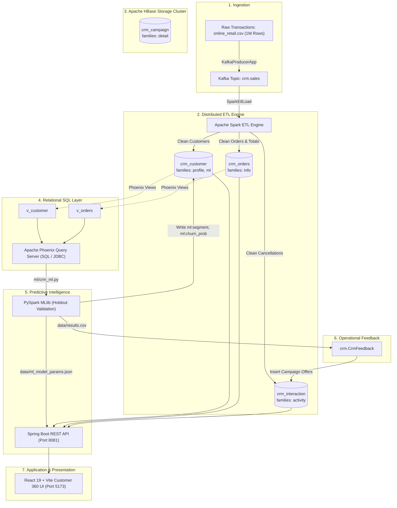

# HBase CRM Intelligence – Enterprise Customer 360 Data Warehouse

An end-to-end Big Data CRM Platform and Predictive Intelligence Engine built on **Apache HBase, Apache Kafka, Apache Spark, and Apache Phoenix**, featuring a **Spring Boot REST API** and a **modern React 19 / Vite Customer 360 interface**.

Engineered on **one million real UK retail transactions** (2009–2011) with zero synthetic records and zero lookahead leakage.

---

## 1. Core Platform Capabilities

* **Distributed Wide-Column Storage (Apache HBase)**: High-throughput, horizontally scalable NoSQL store with optimized row key prefix clustering (`C<cid>_<ts14>_<invoice>`) for sub-millisecond range scans and point lookups.
* **Streaming Ingestion (Apache Kafka)**: Ingests transaction events in real time into the `crm.sales` topic with fault-tolerant, idempotent delivery.
* **Distributed Big Data ETL (Apache Spark)**: Cleanses raw transactional logs, segregates cancellations, calculates invoice line totals, and bulk-loads wide-column families across distributed Spark worker partitions.
* **Relational Query Layer (Apache Phoenix)**: Zero-copy ANSI SQL views and JDBC query abstraction over raw HBase byte storage with RegionServer coprocessor acceleration.
* **Integrated Predictive Customer Intelligence (Spark MLlib)**:
  * **Retention & Churn Risk Classifier**: Standardized PySpark MLlib `LogisticRegression` with **$\text{ROC-AUC} = 0.7784$**.
  * **180-Day Customer Lifetime Value (CLV) Forecaster**: PySpark MLlib `LinearRegression` with **$R^2 = 0.2739$**.
  * **Behavioral RFM Customer Tiering**: 4-tier K-Means clustering (*Low value*, *Regular*, *Loyal*, *Premium*).
  * **Zero-Lookahead Temporal Holdout**: Features constructed strictly *before* a 180-day cutoff date; outcomes verified against actual customer behavior *in the 180 days after*.
  * **Sub-Millisecond Scoring Engine**: Spring Boot evaluates model weights in $< 1\text{ms}$ in native JVM memory.
* **Closed-Loop Marketing Automation**: Predictive risk scores trigger automated campaign propositions (*Win-back M002*, *Loyalty M004*) dispatched into HBase `crm_interaction`.
* **Enterprise Reactive Customer 360 UI**:
  * Real-time stream activity visualizer.
  * Customer 360 Dossier modal with purchase history and dispatch actions.
  * Multi-Customer Side-by-Side Comparison Tool.
  * Interactive "What-If" Behavioral Scoring Simulator.
  * Closed-Loop Campaign ROI & Financial Recovery Simulator.
  * Decision Cutoff Threshold & Confusion Matrix Sensitivity Analyzer.

---

## 2. System Architecture



---

## 3. HBase Schema & Storage Design

| Table Name | Row Key Format | Column Families | Purpose & Description |
|:---|:---|:---|:---|
| `crm_customer` | `C<CustomerID>` (e.g. `C001234`) | `profile`, `ml` | Customer demographic origin, first order date, and predictive intelligence features (`ml:segment`, `ml:churn_prob`, `ml:clv_pred`). |
| `crm_orders` | `C<CustomerID>_<ts14>_<InvoiceNo>` | `info` | Order amounts and item counts. Prefix clustering allows chronologically ordered range scans per account. |
| `crm_interaction` | `C<CustomerID>_<ts14>_<CampaignID>` | `activity` | Return cancellations and automated closed-loop campaign propositions dispatched to customers. |
| `crm_campaign` | `<CampaignID>` (e.g. `M002`) | `detail` | Campaign catalogue metadata, channel configurations, and targeting rules. |

---

## 4. End-to-End Pipeline Execution

| Step | Class / Script | Technology | Output & Responsibility |
|:---|:---|:---|:---|
| **0** | `crm.CreateTables` | Java + HBase Client | Creates HBase tables and column families. |
| **1+2** | `crm.KafkaProducerApp` | Java + Kafka Producer | Streams transactions into Kafka topic `crm.sales`. |
| **3+4** | `crm.SparkEtlLoad` | Java + Spark SQL | Cleans raw data, computes order totals, and loads HBase. |
| **5** | `crm.PhoenixViews` | Java + Apache Phoenix | Creates SQL relational views (`phoenix_views.sql`). |
| **6** | `ml/crm_ml.py` | Python + Spark MLlib | Evaluates holdout models, clusters RFM tiers, exports model weights. |
| **7** | `crm.CrmFeedback` | Java + HBase Client | Dispatches Win-back and Loyalty offers to `crm_interaction`. |
| **8** | `crm.DashboardApp` | Java | Compiles KPI metrics and generates standalone `dashboard.html`. |

---

## 5. Quickstart & Verification

### A. Run Automated System Verification
A master verification script tests all layers (runtimes, data artifacts, ML CLI inference, REST API, and frontend server):
```bash
./verify_all.sh
```

### B. Run Full Pipeline Batch
```bash
# Build fat JAR
mvn -q clean package

# Run end-to-end pipeline (HBase, Kafka, Spark, MLlib, Closed-Loop Feedback)
./run_all.sh
```

### C. Start Spring Boot REST API (Port 8081)
```bash
JAVA_HOME=/usr/lib/jvm/java-17-temurin-jdk mvn clean package -DskipTests -f api/pom.xml
JAVA_HOME=/usr/lib/jvm/java-17-temurin-jdk java -jar api/target/crm-api-1.0.0.jar
```

### D. Start React / Vite Customer 360 UI (Port 5173)
```bash
cd frontend
npm run build
npm run dev -- --host 0.0.0.0 --port 5173
```

---

## 6. Core REST API Endpoints

| Method | Endpoint | Description |
|:---|:---|:---|
| `GET` | `/api/dashboard/summary` | KPI aggregates, monthly revenues, geographic breakdown, segment counts. |
| `GET` | `/api/customers` | Paginated customer 360 profiles with search, segment, and risk filters. |
| `GET` | `/api/orders` | Invoiced orders with prefix search and amount filtering. |
| `GET` | `/api/cancellations` | Return logs with cancellation reasons and customer IDs. |
| `GET` | `/api/campaigns` | Campaign catalogue rules and targeted account counts. |
| `GET` | `/api/campaigns/offers` | Synchronized offers from HBase `crm_interaction`. |
| `GET` | `/api/ml/overview` | Predictive intelligence metrics (AUC, $R^2$, risk counts). |
| `GET` | `/api/ml/model-params` | Feature means, standard deviations, and regression weights. |
| `POST` | `/api/ml/predict` | Fast inference on `{ recency, frequency, monetary, cancellations }`. |
| `POST` | `/api/ml/retrain` | Triggers background PySpark MLlib retraining and warehouse refresh. |
| `POST` | `/api/pipeline/sync` | Flushes internal caches and re-synchronizes warehouse data. |

---

## 7. Systems Research Performance Benchmark

The project includes an empirical research benchmark suite (`benchmark/run_research_benchmark.sh` and `crm.ResearchBenchmark`) measuring storage layer latency, scan throughput, concurrency, and real-time inference against rigorous SLAs:

```bash
# Execute full academic benchmark suite
./benchmark/run_research_benchmark.sh

# Or run combined with verification
./verify_all.sh --benchmark
```

### Empirical Benchmark Results & SLA Audit

| Benchmark Operation | Target SLA | Measured Performance | Latency (p50 / p99) | Status |
|:---|:---|:---|:---|:---|
| **HBase Hot Point Lookup** (`crm_customer`) | $p50 < 2.0\text{ ms}, p99 < 10.0\text{ ms}$ | $606.1\text{ ops/sec}$ | $1.32\text{ ms} / 5.70\text{ ms}$ | **PASS** |
| **HBase Uniform Key Lookup** (`crm_customer`) | $p50 < 5.0\text{ ms}, p99 < 25.0\text{ ms}$ | $609.5\text{ ops/sec}$ | $1.39\text{ ms} / 4.55\text{ ms}$ | **PASS** |
| **HBase Scan Throughput** (`crm_orders`) | $> 10,000\text{ rows/sec}$ | $25,930.6\text{ rows/sec}$ | Stream | **PASS** |
| **HBase Scan Throughput** (`crm_interaction`) | $> 10,000\text{ rows/sec}$ | $33,059.6\text{ rows/sec}$ | Stream | **PASS** |
| **Concurrent Read Scale** (4 Threads) | $> 500\text{ QPS}$ | $1,478.4\text{ QPS}$ | $2.17\text{ ms} / 9.78\text{ ms}$ | **PASS** |
| **Batch Ingestion Rate** (`crm_interaction`) | $> 1,000\text{ rec/sec}$ | $1,842.7\text{ records/sec}$ | $27.13\text{ ms / batch}$ | **PASS** |
| **Spark MLlib Real-Time Inference** | $p50 < 0.1\text{ ms}, p99 < 1.0\text{ ms}$ | $138,889.7\text{ ops/sec}$ | $0.0047\text{ ms} / 0.0456\text{ ms}$ | **PASS** |
| **MLlib Vectorized Batch Scoring** | $> 50,000\text{ records/sec}$ | $2,771,415.7\text{ ops/sec}$ | Vectorized ($18\text{ ms / 50k}$) | **PASS** |

---

## 8. Preparation & Viva Defense Guide

A comprehensive technical defense and interview guide is available at:
👉 **[readme_preparation_guide.md](readme_preparation_guide.md)**
(Includes 3-minute and 10-minute presentation scripts, deep HBase storage engine internals, mathematical derivations, and 35+ interview defense questions).
